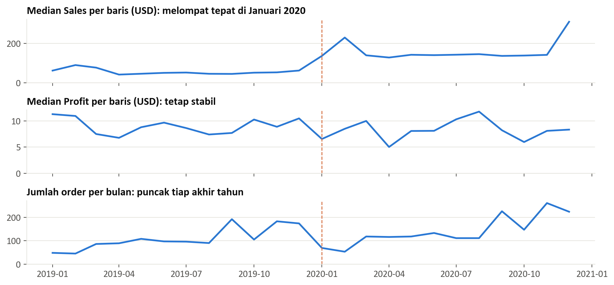
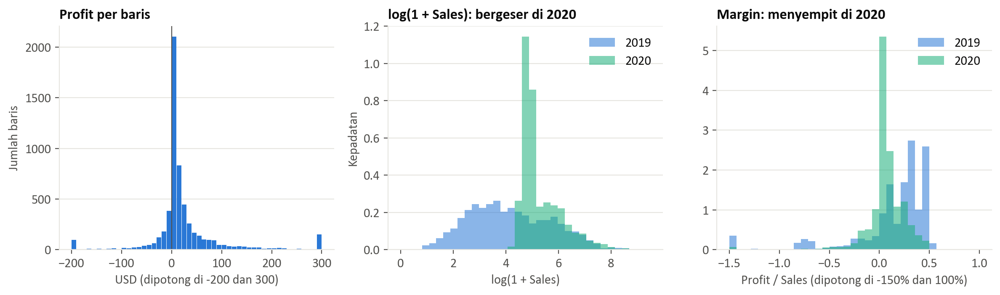
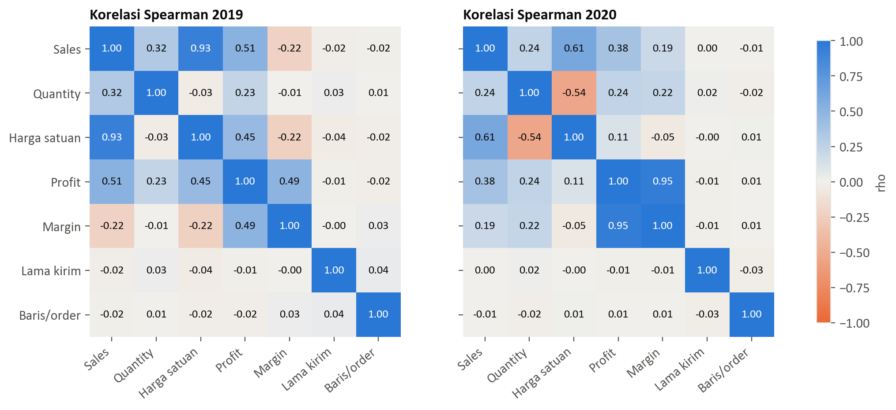
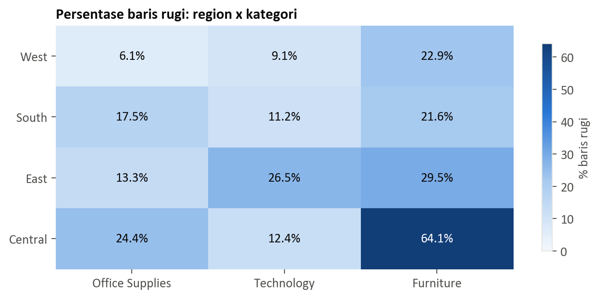
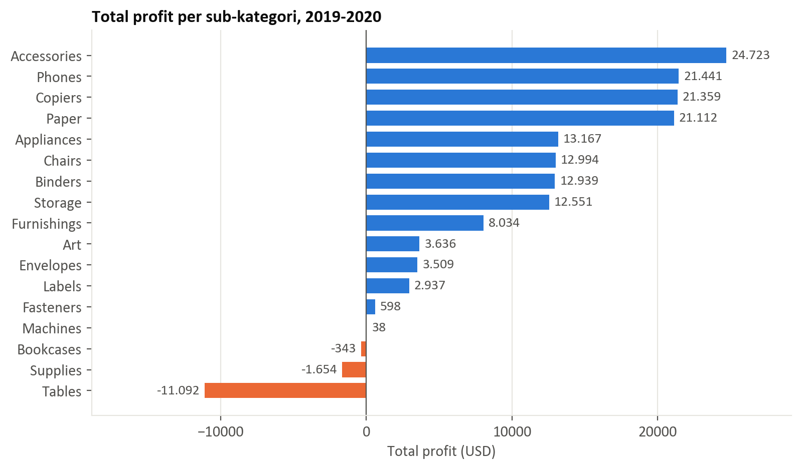
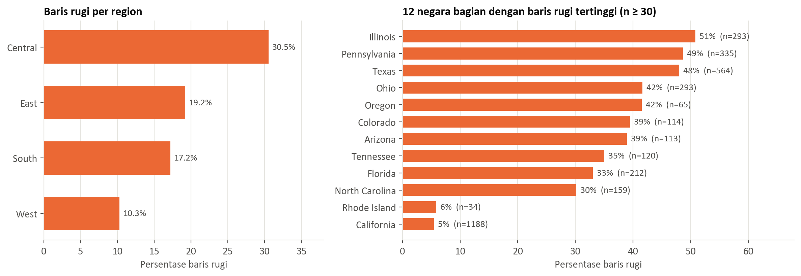

# UTS Business Information System Engineering

Soal dan jawaban Ujian Tengah Semester mata kuliah Business Information System Engineering (MT117), S2 Informatika, Semester Ganjil 2026/2027. Dataset yang dikerjakan adalah Superstore Sales.

**Laporan versi Word:** [UTS_BISE_Laporan_Superstore.docx](UTS_BISE_Laporan_Superstore.docx)

## Anggota Kelompok

| No | Nama | NIM |
|---|---|---|
| 1 | Muhammad Abiyyu Rahman | 25.51.1738 |
| 2 | Muhammad Gufron Hawaly | 25.51.1735 |
| 3 | I Kadek Wibisana Wraspati Yuda | 25.51.1740 |
| 4 | Elsa Monica Putri | 25.51.1809 |

**Dosen pengampu:** Robert Marco, S.T., M.T., Ph.D dan Dr. Hartatik, S.T., M.Cs

## Soal

**Petunjuk**

1. Tugas kelompok maksimal 3 mahasiswa dan wajib memilih 1 Dataset (dari 3 dataset yang tersedia)
2. Analisis dilakukan secara kuantitatif dan interpretatif.
3. Jawaban disusun dalam bentuk laporan singkat + visualisasi (grafik/tabel).
4. Sertakan insight pemasaran / keputusan bisnis dari hasil analisis.

**Dataset**

- Dataset 1, IHSG Stock Data: https://www.kaggle.com/datasets/muamkh/ihsgstockdata/data
- Dataset 2, Superstore Sales Dataset: https://www.kaggle.com/datasets/ayush12nagar/superstore-sales-dataset
- Dataset 3, Coffee Shop Dataset: https://www.kaggle.com/datasets/ahmedabbas757/coffee-sales

**Tugas**

1. Jelaskan preprocessing data secara detail (Pilih tahapan preprocessing yang sesuai dengan data yang dipilih), seperti:
   - a. Data Cleaning (Penangan missing value, data duplikat)
   - b. Data Filtering dan outlier handling
   - c. Feature Transformation
   - d. Feature Engineering
   - e. Dimensionality Reduction dan Feature Selection
   - f. Split data
2. Analisis Statistik Deskriptif dan Distribusi Data? Jelaskan
3. Uji Statistik Inferensial dan Hubungan Antar Variabel? Jelaskan
4. Tambahkan tampilan visualisasi (Heatmap, Histogram, Bar Chart)? Jelaskan

# Jawaban

## Ringkasan Jawaban

Setelah dibersihkan, data berisi 5.887 baris transaksi dari 3.000 order (2019–2020) dengan profit bersih **$145.951**. Masalah utamanya adalah kebocoran profit: transaksi rugi menggerus $91.710, atau 38,6% dari keuntungan kotor $237.660. Kerugian ini terkonsentrasi dan dapat diprediksi.

- **Kerugian terkonsentrasi secara geografis.** 10 negara bagian yang bernilai negatif mencakup 38,5% baris, tetapi menyumbang 94,0% nilai kerugian. Region Central rugi pada 30,5% barisnya, dibanding West 10,3%.
- **Produk memperkuat pola tersebut.** 64% baris Tables merugi, dan Furniture di Central merugi pada 64,1% baris.
- **Segmen pelanggan tidak membedakan profit** (Cramér's V = 0,008, tidak signifikan). Keputusan harga sebaiknya berbasis wilayah dan produk, bukan segmen.
- **Retur West 13,0%**, tiga sampai enam kali region lain (order 2020).
- **Risiko rugi dapat diprediksi** sebelum pengiriman dengan ROC-AUC 0,950 pada data uji.

> **Temuan kualitas data yang menentukan analisis.** Mulai 1 Januari 2020, nilai Sales bergeser sehingga Sales dan margin 2020 tidak sebanding dengan 2019, sementara Profit tetap stabil. Karena itu laporan ini memakai **Profit dan status rugi** sebagai metrik utama, dan klaim seperti “Sales naik” atau “margin anjlok” tidak dibuat. Buktinya ada di Jawaban Soal 1 bagian b.

## Dataset yang Dipilih

Kami memilih **Dataset 2, Superstore Sales** (kaggle.com/datasets/ayush12nagar/superstore-sales-dataset) karena memuat profit, segmen pelanggan, wilayah, produk, dan retur, sehingga paling langsung menghasilkan keputusan pemasaran. Data mentah berukuran 5.901 baris × 23 kolom. Setiap baris adalah satu item dalam satu order, periode 2019-01-01 sampai 2020-12-31, seluruhnya di Amerika Serikat. Satuan uang tidak dinyatakan di data dan kami asumsikan USD.

**Pertanyaan bisnis:** di mana perusahaan kehilangan profit, apa yang berhubungan dengannya, dan keputusan apa yang perlu diambil? Untuk tahap pemodelan, target disiapkan berupa `Is_Loss` (1 jika Profit < 0).

## Jawaban Soal 1: Preprocessing Data

### a. Data Cleaning

**Tabel 1.** Hasil data cleaning

| **Masalah** | **Temuan** | **Tindakan dan alasan** |
|---|---|---|
| Kolom kosong | `ind1` dan `ind2` kosong 100% (5.901 baris) | Dihapus karena tidak berisi informasi. |
| Missing `Returns` | Kosong 5.614 baris; isi hanya bernilai 1. Tidak ada satu pun retur tercatat pada 2019 (0 dari 1.315 order) | 2020: kosong diartikan tidak retur (0). 2019: tetap kosong karena tidak diketahui, bukan nol. Analisis retur hanya memakai 2020. |
| Duplikat | Duplikat persis 0. `Row ID` ganda 1 tetapi transaksinya berbeda. Order + produk sama: 7 pasang dengan jumlah berbeda | Tidak ada baris dihapus karena semuanya transaksi berbeda. `Row ID` dibuang karena bukan pengenal yang andal. |
| Tipe dan konsistensi | Tanggal bertipe teks (dd-mm-yyyy); 1 order punya dua tanggal; nama kolom pertama rusak | Tanggal diparse, tanggal order diseragamkan ke yang paling awal, kolom diganti nama. |
| Kolom tidak berguna | `Country` konstan; `Customer Name` duplikat dari ID; `Product Name` tidak konsisten (28 Product ID punya >1 nama) | Dihapus. Identitas cukup memakai ID dan nama pribadi tidak diperlukan untuk analisis. |

### b. Data Filtering dan Outlier Handling

**Pergeseran Sales 2020.** Median Sales per baris melompat dari $52,34 (2019) ke $145,25 (2020), sedangkan median Profit ($8,72 ke $8,24) dan persentase baris rugi (18,5% ke 18,8%) nyaris tidak berubah. Untuk mengujinya, kami membandingkan pasangan transaksi dengan produk, jumlah, dan profit yang sama persis:

**Tabel 2.** Bukti pergeseran Sales: transaksi dengan produk, jumlah, dan profit yang sama

| **Pasangan yang dibandingkan** | **Jumlah pasangan** | **Sales identik** | **Selisih tepat bilangan bulat** | **Median selisih** |
|---|---|---|---|---|
| Sesama 2019 | 135 | 100,0% | 0,0% | $0,00 |
| 2019 dengan 2020 | 332 | 0,0% | 100,0% | $87,50 |
| Sesama 2020 | 203 | 2,0% | 97,5% | $19,00 |

Pada 2019 transaksi yang sama selalu bernilai sama, sedangkan yang melibatkan 2020 hampir selalu berbeda sebesar bilangan bulat. Pola ini mengarah pada perubahan pencatatan atau rekayasa nilai, bukan kenaikan penjualan nyata; harga satuan median per produk pun naik 3,0 kali lipat dalam semalam. Penyebab pastinya tidak dapat dipastikan dari data, dan nilai aslinya tidak dapat dipulihkan. **Keputusan:** Sales dan margin hanya dibandingkan dalam tahun yang sama, dan fitur Sales distandardisasi per tahun.



**Gambar 1.** Median Sales melompat tepat pada Januari 2020 (garis putus-putus), sedangkan median Profit tetap stabil. Jumlah order memuncak setiap akhir tahun.

**Nilai yang mustahil.** 14 baris memiliki Profit > Sales, yang berarti biaya negatif, sehingga **dihapus**. Dampaknya besar: profit total turun $29.312 (16,7%). Sebanyak 15 baris lain bermargin 50–100%. Baris ini mencurigakan karena 4.735 baris untung lainnya tidak pernah melewati 50%, tetapi secara logika masih mungkin, sehingga **dipertahankan dan ditandai** (`Flag_Margin_Tinggi`). Filter lain tidak menemukan masalah: tanggal kirim sebelum order 0 baris dan Sales ≤ 0 sebanyak 0 baris.

**Outlier statistik.** Metode IQR menandai 1.120 baris Profit (19,0%) dan 86 baris Quantity (1,5%). Baris ini **tidak dihapus** karena transaksi ekstrem justru informasi bisnis: 54,1% nilai kerugian berasal dari 5% baris rugi terburuk. Dampaknya ditangani dengan transformasi log dan uji berbasis peringkat. Kerugian melebihi nilai Sales (108 baris) juga dipertahankan karena masih mungkin terjadi.

**Tabel 3.** Sensitivitas: pola utama stabil, tetapi nilai total bergantung pada penanganan anomali

| **Skenario** | **Baris** | **Total profit** | **Technology** | **Office Supplies** | **% rugi Central** | **% rugi West** |
|---|---|---|---|---|---|---|
| Semua baris dipertahankan | 5.901 | $175.262 | $90.458 | $74.797 | 30,4% | 10,3% |
| Dipakai: buang Profit > Sales | 5.887 | $145.951 | $67.561 | $68.795 | 30,5% | 10,3% |
| Buang semua margin > 50% | 5.872 | $134.024 | $57.686 | $67.789 | 30,6% | 10,3% |

Persentase rugi per region hampir tidak berubah, jadi temuan utama tidak bergantung pada keputusan ini. Sebaliknya, peringkat total profit Technology dan Office Supplies dapat bertukar, sehingga keduanya sebaiknya dianggap setara. Machines juga rapuh: profitnya $38, tetapi menjadi −$2.762 tanpa satu baris yang ditandai.

### c. Feature Transformation

- **Log:** `log(1 + Sales)` dan `log(1 + harga satuan)` karena distribusinya sangat miring. Skewness Sales 2019 turun dari 6,75 menjadi 0,29; pada 2020 dari 5,39 menjadi 1,46.
- **Standardisasi per tahun** untuk Sales dan harga satuan agar pergeseran 2020 tidak terbaca sebagai sinyal; **StandardScaler** untuk fitur numerik lain.
- **One-hot encoding** untuk Sub-Category, Region, Segment, Ship Mode, dan Payment Mode karena nominal, dengan satu kategori acuan dihapus.
- **Target encoding** untuk State (49 kategori) dengan smoothing dan skema out-of-fold per order, agar jumlah kolom tidak meledak dan target tidak bocor.
- **Sin dan cos bulan** agar Desember dan Januari terbaca berdekatan.

Semua parameter transformasi dihitung dari data train saja, lalu diterapkan ke data validasi dan test.

### d. Feature Engineering

**Tabel 4.** Fitur hasil feature engineering

| **Fitur baru** | **Definisi** | **Kegunaan** |
|---|---|---|
| `Is_Loss` | 1 jika Profit < 0 | Target; metrik utama kebocoran profit |
| `Profit_Margin` | Profit / Sales | Analisis dalam tahun yang sama; tidak dipakai sebagai fitur model karena membocorkan target |
| `Unit_Price` | Sales / Quantity | Tingkat harga produk |
| `Ship_Lead_Days` | Ship Date − Order Date | Kinerja logistik; tidak dipakai model karena baru diketahui setelah order |
| `Order_Lines` | Jumlah baris dalam satu order | Ukuran keranjang belanja |
| `Customer_Prior_Orders` | Jumlah order pelanggan sebelumnya | Loyalitas; tidak dipakai model karena nilainya naik mengikuti waktu (lihat Jawaban Soal 3) |
| Komponen waktu | Tahun, bulan, kuartal, akhir pekan | Musiman dan kontrol tahun |

### e. Dimensionality Reduction dan Feature Selection

**PCA** membutuhkan 15 dari 34 komponen untuk menjelaskan 90,9% varians, dengan dua komponen pertama hanya 20,2% dan 12,2%. Artinya tidak ada struktur berdimensi rendah yang kuat. **Seleksi fitur** menggabungkan dua pendekatan dengan tiga skor: filter (mutual information), embedded (Lasso L1 dan Random Forest importance). Variabel lolos jika masuk 6 besar pada minimal 2 dari 3 skor, dan dinilai per variabel supaya kategori tidak terpecah.

**Tabel 5.** Skor seleksi fitur per variabel (dihitung hanya pada data train, lihat Jawaban Soal 1 bagian f)

| **Variabel** | **Mutual info** | **Lasso \|koef\|** | **RF importance** | **Vote** | **Status** |
|---|---|---|---|---|---|
| State_Loss_TE | 0,154 | 1,386 | 0,449 | 3 | Dipilih |
| Sub-Category | 0,089 | 3,154 | 0,263 | 3 | Dipilih |
| Unit_Price_Z | 0,072 | 0,202 | 0,080 | 3 | Dipilih |
| Sales_Z | 0,028 | 0,005 | 0,061 | 3 | Dipilih |
| Region | 0,013 | 0,000 | 0,046 | 2 | Dipilih |
| Bulan (sin+cos) | 0,013 | 0,000 | 0,031 | 2 | Dipilih |
| Quantity | 0,002 | 0,000 | 0,019 | 0 | Dibuang |
| Order_Lines | 0,006 | 0,000 | 0,017 | 0 | Dibuang |
| Ship Mode | 0,001 | 0,000 | 0,010 | 0 | Dibuang |
| Payment Mode | 0,000 | 0,000 | 0,010 | 0 | Dibuang |
| Segment | 0,000 | 0,000 | 0,009 | 0 | Dibuang |
| Is_Weekend | 0,001 | 0,000 | 0,004 | 0 | Dibuang |

**Tabel 6.** Perbandingan set fitur memakai Logistic Regression

| **Set fitur** | **Jumlah fitur** | **AUC validasi** | **AUC test (CI 95%)** | **PR-AUC test** | **Recall** | **Precision** |
|---|---|---|---|---|---|---|
| Semua kandidat | 34 | 0,957 | 0,948 (0,936–0,961) | 0,825 | 0,915 | 0,629 |
| Seleksi per variabel | 24 | 0,958 | 0,950 (0,938–0,962) | 0,833 | 0,906 | 0,625 |
| Seleksi per dummy | 12 | 0,935 | 0,915 (0,895–0,935) | 0,785 | 0,855 | 0,526 |
| PCA 15 komponen | 15 | 0,899 | 0,865 (0,840–0,893) | 0,707 | 0,838 | 0,439 |

**Keputusan:** dipakai **seleksi per variabel**, karena dengan 24 fitur kinerjanya setara dengan semua kandidat (AUC validasi tertinggi), sedangkan PCA dan seleksi per dummy menurunkan kinerja. Sebagai pembanding, proporsi kelas rugi pada data test adalah 0,200, jadi PR-AUC 0,833 jauh di atas tebakan acak. Tanpa fitur Sales dan harga satuan, AUC tetap 0,950, sehingga sinyal utamanya berasal dari wilayah dan produk, bukan dari Sales yang bermasalah. Data final setelah model dilatih ulang pada train + validasi: train 4.713 × 24 dan test 1.174 × 24, tanpa nilai kosong maupun tak hingga.

### f. Split Data

Data dibagi secara **kronologis**, bukan acak, karena model nantinya memprediksi transaksi masa depan. Satu order tidak pernah terpecah sehingga tidak ada kebocoran antarbagian (order yang tumpang tindih: 0).

**Tabel 7.** Pembagian data

| **Bagian** | **Periode** | **Baris** | **% rugi** | **Fungsi** |
|---|---|---|---|---|
| Train | 2019-01-01 s.d. 2020-06-30 | 3.772 | 19,0% | Melatih model dan memilih fitur |
| Validasi | 2020-07-01 s.d. 2020-10-02 | 941 | 15,4% | Membandingkan set fitur |
| Test | 2020-10-03 s.d. 2020-12-31 | 1.174 | 20,0% | Evaluasi akhir |

Proporsi rugi sekitar 19% tergolong tidak seimbang, tetapi kami memakai `class_weight="balanced"` dan tidak memakai oversampling, supaya tidak menciptakan transaksi sintetis.

## Jawaban Soal 2: Statistik Deskriptif dan Distribusi Data

**Tabel 8.** Statistik deskriptif (margin dalam persen; Sales dan margin dipisah per tahun)

| **Variabel** | **n** | **Mean** | **Median** | **Std** | **Q1** | **Q3** | **Min** | **Maks** | **Skew** | **Kurt** |
|---|---|---|---|---|---|---|---|---|---|---|
| Profit | 5.887 | 24,79 | 8,49 | 201,96 | 1,79 | 28,20 | −6.599,98 | 5.039,99 | −3,97 | 337,0 |
| Quantity | 5.887 | 3,8 | 3,0 | 2,2 | 2,0 | 5,0 | 1,0 | 14,0 | 1,21 | 1,7 |
| Lama kirim (hari) | 5.887 | 3,9 | 4,0 | 1,8 | 3,0 | 5,0 | 0,0 | 8,0 | −0,39 | −0,4 |
| Sales 2019 | 2.583 | 217,19 | 52,34 | 491,96 | 17,94 | 206,41 | 0,84 | 9.099,93 | 6,75 | 72,0 |
| Sales 2020 | 3.304 | 300,81 | 145,25 | 450,64 | 117,31 | 293,94 | 36,17 | 5.517,97 | 5,39 | 40,3 |
| Harga satuan 2019 | 2.583 | 58,44 | 15,99 | 116,44 | 5,78 | 62,18 | 0,34 | 1.637,53 | 5,85 | 51,8 |
| Harga satuan 2020 | 3.304 | 96,23 | 55,78 | 140,62 | 33,95 | 111,58 | 7,34 | 3.269,98 | 8,25 | 123,8 |
| Margin 2019 | 2.583 | 12,9 | 27,0 | 44,5 | 7,2 | 36,2 | −270,0 | 62,9 | −2,83 | 10,2 |
| Margin 2020 | 3.304 | 5,8 | 5,6 | 24,3 | 1,1 | 14,6 | −537,3 | 98,0 | −6,36 | 97,8 |

**Profit** bersifat sangat tidak normal: rata-rata $24,79 jauh di atas median $8,49, skewness −3,97, kurtosis 337, dan rentang −$6.600 sampai $5.040. Sebagian besar transaksi untung kecil, tetapi segelintir transaksi rugi besar menentukan hasil akhir. Maka median dan persentase rugi lebih representatif daripada rata-rata. **Uji normalitas** D'Agostino K² menolak normalitas pada semua variabel (p < 0,001), termasuk Sales setelah transformasi log, sehingga analisis inferensial memakai uji nonparametrik.

**Tabel 9.** Ringkasan per region, kategori, dan segmen

| **Kelompok** | **Baris** | **Total profit** | **Median profit** | **% baris rugi** | **Margin 2019** | **Nilai rugi** |
|---|---|---|---|---|---|---|
| West | 1.899 | $60.132 | $10,73 | 10,3% | 13,0% | −$15.445 |
| East | 1.682 | $46.701 | $8,10 | 19,2% | 11,0% | −$28.680 |
| South | 930 | $26.294 | $8,35 | 17,2% | 20,0% | −$15.429 |
| Central | 1.376 | $12.824 | $5,31 | 30,5% | 5,5% | −$32.156 |
| Office Supplies | 3.566 | $68.795 | $6,92 | 14,3% | 17,2% | −$32.563 |
| Technology | 1.073 | $67.561 | $22,00 | 15,2% | 15,7% | −$24.537 |
| Furniture | 1.248 | $9.594 | $7,37 | 34,0% | 3,6% | −$34.611 |
| Consumer | 2.993 | $68.516 | $8,49 | 18,3% | 11,2% | −$42.753 |
| Corporate | 1.769 | $47.553 | $8,67 | 18,9% | 11,8% | −$29.320 |
| Home Office | 1.125 | $29.882 | $8,22 | 19,1% | 14,0% | −$19.637 |

Central dan Furniture menonjol sebagai titik lemah, sementara ketiga segmen hampir sama. Antartahun, jumlah order naik dari 1.313 ke 1.687 (28,5%) dan profit naik dari $66.871 ke $79.079 (18,3%). Kuartal IV menyumbang 36,5% order tetapi hanya 29,5% profit. Dari sisi pelanggan, 20% teratas menghasilkan 93% profit bersih dan 19% pelanggan bernilai negatif.

## Jawaban Soal 3: Uji Statistik Inferensial dan Hubungan Antar Variabel

Karena data tidak normal, kami memakai **Kruskal-Wallis** dan **Mann-Whitney** untuk Profit, **Chi-square** untuk variabel kategorik, dan **Spearman** untuk korelasi, dengan taraf signifikansi α = 0,05. Nilai p dikoreksi metode **Holm** karena banyak uji dilakukan sekaligus. Dengan ribuan baris, efek kecil pun mudah signifikan, sehingga **ukuran efek** ikut dilaporkan. H₀ setiap uji: tidak ada perbedaan atau hubungan antarkelompok.

**Tabel 10.** Hasil uji inferensial

| **Hubungan** | **Uji** | **Data** | **Statistik (df)** | **p Holm** | **Ukuran efek** | **Keputusan** |
|---|---|---|---|---|---|---|
| Profit × Category | Kruskal-Wallis | semua | 223,0 (2) | < 0,001 | ε² = 0,038 | **Tolak H₀** |
| Profit × Region | Kruskal-Wallis | semua | 117,5 (3) | < 0,001 | ε² = 0,019 | **Tolak H₀** |
| Profit × Segment | Kruskal-Wallis | semua | 1,0 (2) | 1,000 | ε² = 0,000 | Gagal tolak |
| Profit × Ship Mode | Kruskal-Wallis | semua | 8,1 (3) | 0,392 | ε² = 0,001 | Gagal tolak |
| Profit × Payment Mode | Kruskal-Wallis | semua | 1,2 (2) | 1,000 | ε² = 0,000 | Gagal tolak |
| Status rugi × Sub-Category | Chi-square | semua | 1.130,9 (16) | < 0,001 | Cramér's V = 0,438 | **Tolak H₀** |
| Status rugi × Category | Chi-square | semua | 245,5 (2) | < 0,001 | Cramér's V = 0,204 | **Tolak H₀** |
| Status rugi × Region | Chi-square | semua | 217,4 (3) | < 0,001 | Cramér's V = 0,192 | **Tolak H₀** |
| Status rugi × Segment | Chi-square | semua | 0,4 (2) | 1,000 | Cramér's V = 0,008 | Gagal tolak |
| Status rugi × Ship Mode | Chi-square | semua | 7,6 (3) | 0,439 | Cramér's V = 0,036 | Gagal tolak |
| Status rugi × Payment Mode | Chi-square | semua | 1,2 (2) | 1,000 | Cramér's V = 0,015 | Gagal tolak |
| Status rugi × Negara bagian | Chi-square | semua | 1.550,7 (31) | < 0,001 | Cramér's V = 0,513 | **Tolak H₀** |
| Retur × Region | Chi-square | order 2020 | 64,4 (3) | < 0,001 | Cramér's V = 0,195 | **Tolak H₀** |
| Retur × Segment | Chi-square | order 2020 | 0,2 (2) | 1,000 | Cramér's V = 0,010 | Gagal tolak |
| Retur × Ship Mode | Chi-square | order 2020 | 1,7 (3) | 1,000 | Cramér's V = 0,032 | Gagal tolak |
| Profit × Retur | Mann-Whitney | baris 2020 | 461.084,0 | 0,439 | rank-biserial = 0,068 | Gagal tolak |

**Interpretasi:**

- **Negara bagian** (V = 0,51; 32 kelompok, yang n < 30 digabung) dan **sub-kategori** (V = 0,44) adalah pembeda terkuat status rugi, dengan efek kuat, diikuti **kategori** (V = 0,20) dan **region** (V = 0,19). Pola ini konsisten pada kedua tahun: V region 0,17 dan 0,21, V sub-kategori 0,42 dan 0,45.
- Untuk nilai **Profit**, perbedaan kategori dan region signifikan tetapi efeknya kecil (ε² = 0,038 untuk kategori). Jadi variasi terbesar Profit ada di tingkat transaksi, dan status rugi lebih informatif untuk keputusan.
- **Segmen, cara kirim, dan cara bayar tidak berhubungan** secara signifikan dengan profit maupun status rugi.
- **Retur** berhubungan dengan region (V = 0,20): West 13,0%, sedangkan keseluruhan 6,2%. Profit baris yang diretur tidak berbeda signifikan.

**Uji lanjut region** (Mann-Whitney berpasangan, Holm): semua pasangan berbeda signifikan kecuali East vs South. Perbedaan terbesar adalah West dengan Central (median $10,73 dan $5,31).

**Tabel 11.** Korelasi Spearman per tahun

| **Pasangan variabel** | **ρ gabungan** | **ρ 2019 (CI 95%)** | **p Holm 2019** | **ρ 2020 (CI 95%)** | **p Holm 2020** |
|---|---|---|---|---|---|
| Sales – Profit | 0,365 | 0,511 (0,48; 0,54) | < 0,001 | 0,377 (0,35; 0,41) | < 0,001 |
| Sales – Quantity | 0,224 | 0,315 (0,28; 0,35) | < 0,001 | 0,235 (0,20; 0,27) | < 0,001 |
| Quantity – Profit | 0,236 | 0,229 (0,19; 0,27) | < 0,001 | 0,241 (0,21; 0,27) | < 0,001 |
| Harga satuan – Margin | −0,268 | −0,222 (−0,26; −0,18) | < 0,001 | −0,048 (−0,08; −0,01) | 0,038 |
| Lama kirim – Profit | −0,011 | −0,008 (−0,05; 0,03) | 1,000 | −0,014 (−0,05; 0,02) | 1,000 |
| Baris per order – Profit | −0,004 | −0,016 (−0,06; 0,02) | 1,000 | 0,006 (−0,03; 0,04) | 1,000 |
| Order sebelumnya – Margin | −0,201 | 0,001 (−0,04; 0,04) | 1,000 | −0,040 (−0,08; −0,00) | 0,135 |

Sales berhubungan positif sedang dengan Profit, tetapi melemah dari ρ = 0,51 ke 0,38 akibat pergeseran Sales. Lama kirim dan ukuran order tidak berhubungan dengan Profit. **Contoh pentingnya analisis per tahun:** order sebelumnya dan margin tampak berkorelasi negatif bila digabung (ρ = −0,20), yang bisa keliru dibaca sebagai “pelanggan setia kurang menguntungkan”. Per tahun, korelasinya hilang (ρ = 0,00 dan −0,04), karena keduanya hanya sama-sama mengikuti waktu.

**Tabel 12.** Regresi logistik risiko rugi (galat baku cluster per order)

| **Variabel** | **Odds ratio** | **CI 95%** | **p** |
|---|---|---|---|
| Region Central (acuan West) | 4,14 | 3,28 – 5,24 | < 0,001 |
| Region East | 2,16 | 1,70 – 2,74 | < 0,001 |
| Region South | 1,89 | 1,44 – 2,48 | < 0,001 |
| Furniture (acuan Office Supplies) | 3,53 | 2,99 – 4,16 | < 0,001 |
| Technology | 1,17 | 0,94 – 1,44 | 0,153 |
| Corporate (acuan Consumer) | 1,04 | 0,85 – 1,27 | 0,685 |
| Home Office | 1,09 | 0,87 – 1,37 | 0,460 |
| log Sales, standar per tahun | 0,92 | 0,85 – 1,00 | 0,052 |
| Quantity | 1,00 | 0,97 – 1,04 | 0,805 |
| Tahun 2020 (acuan 2019) | 1,05 | 0,88 – 1,25 | 0,585 |

Setelah variabel lain dikendalikan, peluang (odds) rugi di **Central 4,1 kali** West dan pada **Furniture 3,5 kali** Office Supplies. Segmen, Quantity, dan tahun tidak signifikan. Tidak signifikannya tahun memperkuat bahwa risiko rugi stabil antartahun. Model ini sengaja sederhana untuk tujuan penjelasan (pseudo R² = 0,081).

## Jawaban Soal 4: Visualisasi Data

### Histogram



**Gambar 2.** Distribusi Profit, log Sales, dan margin per tahun.

Histogram dipilih untuk melihat bentuk distribusi. Profit terpusat tepat di atas nol dengan ekor panjang di kedua sisi. Log Sales dan margin memperlihatkan dua distribusi yang jelas berbeda antara 2019 dan 2020, yang mendukung keputusan untuk tidak menggabungkan kedua tahun pada variabel berbasis Sales.

### Heatmap



**Gambar 3.** Korelasi Spearman antar variabel numerik, dipisah per tahun.

Heatmap korelasi meringkas banyak hubungan sekaligus. Perbandingan kedua panel memperlihatkan hubungan yang melibatkan Sales melemah pada 2020, misalnya Sales dengan Profit dari 0,51 ke 0,38. Lama kirim dan baris per order hampir nol terhadap semua variabel.



**Gambar 4.** Persentase baris rugi menurut region dan kategori.

Heatmap ini menunjukkan interaksi yang tidak terlihat bila region dan kategori dilihat terpisah. **Furniture di Central merugi pada 64,1% baris**, hampir tiga kali Furniture di West (22,9%). Technology justru lebih bermasalah di East daripada Central, sehingga kebijakan perlu spesifik per kombinasi region dan kategori.

### Bar Chart



**Gambar 5.** Total profit per sub-kategori, 2019–2020.

Bar chart memudahkan perbandingan antarproduk. Tables (−$11.092) dan Supplies (−$1.654) merugi secara total, sedangkan Machines dan Bookcases berada di sekitar impas. Accessories, Phones, Copiers, dan Paper menjadi penopang profit. Copiers menonjol: median $355 per baris, tetapi hanya 32 baris.



**Gambar 6.** Persentase baris rugi per region dan per negara bagian.

Kerugian sangat terkonsentrasi secara geografis. Texas mencatat kerugian bersih terbesar (−$14.202), disusul Illinois (−$9.555), Ohio (−$9.339), dan Pennsylvania (−$9.298). Sebaliknya, California dan New York memiliki persentase rugi di bawah 6%.

## Insight Pemasaran dan Keputusan Bisnis

**Tabel 13.** Rekomendasi berdasarkan prioritas

| **Prioritas** | **Temuan** | **Keputusan yang disarankan** | **Ukuran keberhasilan** |
|---|---|---|---|
| 1. Wilayah rugi | 10 negara bagian: 94% nilai rugi, profit bersih −$60.446 | Audit harga, promosi, dan biaya di Texas, Illinois, Ohio, dan Pennsylvania dulu, lalu batasi promosi di sana lewat uji coba bertahap | % baris rugi; profit per negara bagian |
| 2. Produk rugi | Tables rugi 64% baris; Binders nilai rugi terbesar (−$22.743); Furniture di Central rugi 64% | Tetapkan batas harga minimum untuk Tables dan Furniture di Central; kaji struktur biaya Binders | Profit per sub-kategori |
| 3. Penargetan | Segmen tidak membedakan profit, status rugi, maupun retur | Hentikan penetapan diskon berbasis segmen; gunakan segmen hanya untuk pesan komunikasi | Profit per kampanye |
| 4. Retur West | 13,0% order West diretur, keseluruhan 6,2% | Telusuri alasan retur di West (produk, pengiriman, deskripsi) sebelum menambah anggaran promosi di sana | % retur West |
| 5. Produk unggulan | Paper, Labels, Envelopes, Art, dan Copiers tidak pernah rugi | Jadikan produk utama bundling dan cross-sell, terutama di wilayah rugi | Profit per order |
| 6. Akhir tahun | Kuartal IV: 36,5% order, 29,5% profit | Rencanakan promosi akhir tahun dengan batas margin, bukan mengejar volume semata | Profit Q4 per order |
| 7. Pelanggan | 20% teratas: 93% profit bersih; 19% pelanggan negatif | Program loyalitas untuk pelanggan bernilai tinggi; tinjau syarat untuk pelanggan yang selalu rugi | Retensi pelanggan teratas |
| 8. Peringatan dini | Model memprediksi rugi dengan recall 91% dan precision 62% | Uji coba sebagai alat bantu persetujuan harga, dengan transaksi berisiko ditinjau sebelum diproses | Nilai rugi yang tercegah |

**Skenario peluang:** bila 10 negara bagian tersebut hanya mencapai titik impas, profit bertambah $60.446, atau **41%** dari profit saat ini. Ini gambaran besarnya peluang dengan asumsi volume tetap, bukan proyeksi.

## Keterbatasan

- **Tidak ada kolom diskon maupun biaya.** Penyebab rugi tidak dapat disimpulkan; hubungan yang ditemukan bersifat asosiasi. Rekomendasi perlu diuji coba sebelum diterapkan penuh, dan data diskon perlu diperoleh.
- **Kualitas Sales dipertanyakan.** Sales dan margin 2020 tidak dapat dipulihkan, dan 14 baris yang dihapus memengaruhi profit total sebesar 16,7%. Pemilik data perlu mengonfirmasi penyebabnya.
- **Retur hanya tersedia untuk 2020**, sehingga tidak ada perbandingan antartahun.
- **Periode data hanya dua tahun**, dan data test hanya mencakup kuartal IV 2020, sehingga kinerja model pada musim lain belum teruji.
- **Baris dalam satu order tidak sepenuhnya independen.** Regresi logistik sudah memperhitungkannya, sedangkan uji lain pada tingkat baris dapat sedikit melebih-lebihkan signifikansi; karena itu ukuran efek lebih diutamakan.

## Cara Menjalankan Ulang

Kode dibuat dengan Python 3.12. Jalankan perintah berikut di Git Bash, Linux, atau macOS.

```bash
git clone https://github.com/iuaiyuuu/UTS-BISE.git
```

```bash
cd UTS-BISE
```

```bash
pip install -r requirements.txt
```

```bash
mkdir -p data/raw/superstore
```

```bash
curl -L -o data/raw/superstore.zip https://www.kaggle.com/api/v1/datasets/download/ayush12nagar/superstore-sales-dataset
```

```bash
unzip -o data/raw/superstore.zip -d data/raw/superstore
```

```bash
python analisis_superstore.py
```

```bash
python build_report.py
```

Data mentah tidak disertakan di repositori ini, sehingga perlu diunduh dengan perintah di atas. Skrip analisis menghasilkan `figures/`, `output/results.json`, dan dataset hasil preprocessing di `output/`.
